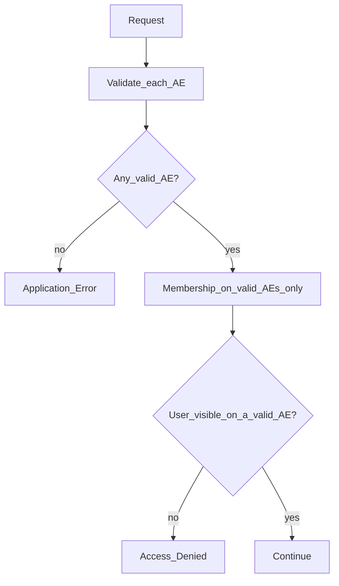

<!-- Classification: AA; Scope: platform; Domain: Platform; Capability: Applications -->
# Application Context resolution

Owner: Architecture

## Ownership

| Concern | Owner |
| --- | --- |
| Application Context establishment (bootstrap, AE resolve, config gate) | **Platform** (SHARED-UI) |
| Required AttributeCodes for the application | **Product application** (declared at registration) |
| Page / feature AttributeCode authorization policy | **Product application** |

The platform remains application-agnostic: it does **not** hardcode `ADMIN`, `INITIATE`, `REPORT`, or any other product AttributeCodes.

## Per-AE validity (platform rule)

Application Context **validity is evaluated independently for each Application Enabled (AE)**.

- A misconfigured AE must **not** automatically invalidate the entire application.
- An AE must be **valid** before it may participate in visibility evaluation, Context Selection, auto-selection, or authorization.
- Invalid AEs are **excluded** from those steps.
- **Application Error** is raised only when **no valid AE** remains available for context establishment.

### Examples

| Example | AE #1 | AE #2 | Result |
| --- | --- | --- | --- |
| A | Valid (e.g. Canada, required AttributeCodes configured) | Invalid (e.g. USA, required AttributeCodes missing) | Application continues using AE #1 only; AE #2 excluded |
| B | Valid | Valid | Normal multi-AE behavior (auto-select or Context Selection among both) |
| C | Invalid | Invalid | **Application Error** — no valid Application Context |

## Evaluation order (mandatory)

### Step 1 — Configuration validation (per AE)

Before memberships or visibility for a given AE:

1. Bootstrap / EAC retrieval succeeds.
2. At least one Application Enabled row exists for the application.
3. For each AE: if the application declared `RequiredAttributeCodes`, **every** required code must be configured (RS3) on **that** AE for it to be **valid**.

| Aggregate outcome | Result |
| --- | --- |
| ≥1 valid AE | Continue; only valid AEs participate in Step 2 and navigation |
| 0 valid AEs | **Application Error** — stop; do not evaluate memberships |

### Step 2 — Membership / visibility (valid AEs only)

Only after Step 1 has identified the valid-AE set:

- Evaluate user AttributeCode memberships against **valid** AEs only.
- Insufficient membership on all valid AEs → **Access Denied**.
- Missing `AE` with 1 / 2+ **valid and visible** contexts → auto-append `AE` / Context Selection (**valid AEs only**).

Access Denied is only possible when at least one valid AE exists.



## Required AttributeCodes scenarios (single AE)

| Scenario | Required | Configured on that AE | Memberships | Outcome |
| --- | --- | --- | --- | --- |
| A | ADMIN, INITIATE, REPORT | all three | none | **Access Denied** (AE valid; auth failed) |
| B | ADMIN, INITIATE, REPORT | none | any | AE **invalid**; if no other valid AE → **Application Error** |
| C | ADMIN, INITIATE, REPORT | ADMIN only | any | AE **invalid**; if no other valid AE → **Application Error** |
| D | none | none | — | No platform config failure for that AE; product policy decides |

## Layers

| Layer | Owner | Responsibility |
| --- | --- | --- |
| Stored procedure | EAC | Facts: AE contexts, memberships, configured AttributeCodes |
| Bootstrap | SHARED-UI | Load facts; derive raw visibility; 60s cache |
| Per-AE config gate | SHARED-UI (`BoApplicationContextConfiguration` + resolver) | Mark each AE valid/invalid; Error only if zero valid |
| AE resolution | SHARED-UI | Auto-select / Context Selection among **valid + visible** AEs |
| Page AttributeCode policy | Product | After a **valid** AE is resolved |

## Registration

```csharp
services.AddBreezeOnApplicationAccess("BREEZEON-CORP-FIN-INV", options =>
{
    options.RequiredAttributeCodes = ["ADMIN", "INITIATE", "REPORT"]; // product-owned
});
```

Empty `RequiredAttributeCodes` = every AE row is configuration-valid (Scenario D).

## Error surface isolation

`/application-error` must not require a resolved AE or completed bootstrap, and must not re-enter the context-resolution pipeline ([error-messages.md](../../docs/ui/shell/error-messages.md)).

Navigate to `/application-error` with **generic** Application Error title/lead/body. Carry a safe `BoApplicationErrorReason` via circuit-scoped `IBoApplicationErrorState` for the **Error Details** panel (expanded by default). Support Details are also expanded by default. No title/message query transport — [error-messages.md](../../docs/ui/shell/error-messages.md).
