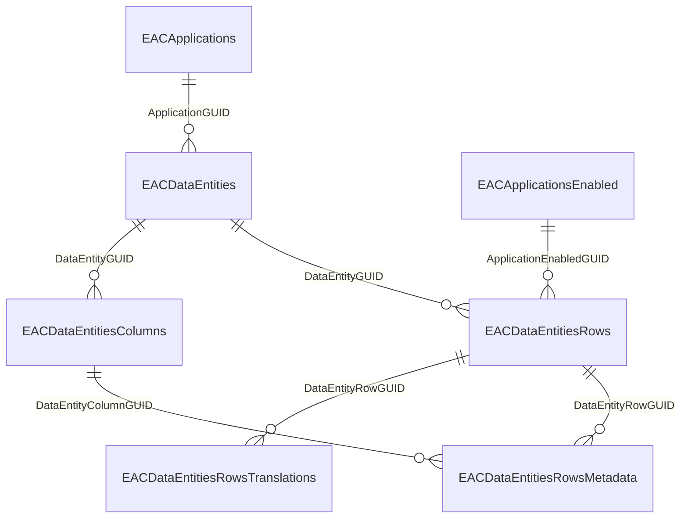

# Data Entities architecture

Owner: Architecture

Technical architecture for the Data Entities platform capability (EAC `System` schema).

## ERD

## Relationships

| Child | Parent key | Notes |
| --- | --- | --- |
| `EACDataEntities` | `ApplicationGUID` | Shared definitions for the Application |
| `EACDataEntitiesColumns` | `DataEntityGUID` | Custom columns only (not code/description/sort-order) |
| `EACDataEntitiesRows` | `ApplicationEnabledGUID` + `DataEntityGUID` | Instance rows per Application Context |
| `EACDataEntitiesRowsTranslations` | `DataEntityRowGUID` | Localized Description only |
| `EACDataEntitiesRowsMetadata` | `DataEntityRowGUID` + `DataEntityColumnGUID` | Sparse typed values |

Logical keys are `NVARCHAR(600)` GUIDs (EAC catalog convention). Physical PKs are `INT IDENTITY`. FKs use `ON DELETE NO ACTION`; cleanup is via centralized delete procedures.

## Constraints (summary)

| Table | Unique |
| --- | --- |
| `EACDataEntities` | `DataEntityGUID`; `(ApplicationGUID, Code)` |
| `EACDataEntitiesColumns` | `DataEntityColumnGUID`; `(DataEntityGUID, Code)`; `Type` CHECK |
| `EACDataEntitiesRows` | `DataEntityRowGUID`; `(ApplicationEnabledGUID, DataEntityGUID, Code)` |
| `EACDataEntitiesRowsTranslations` | `DataEntityRowTranslationGUID`; `(DataEntityRowGUID, LanguageCode)` |
| `EACDataEntitiesRowsMetadata` | `(DataEntityRowGUID, DataEntityColumnGUID)` |

Full column inventory: EAC [`docs/db-model.md`](https://github.com/Breeze-On/SYSTEM-ADMIN-EAC/blob/main/docs/db-model.md).

## Indexing strategy

| Index | Purpose |
| --- | --- |
| `IX_EACDataEntities_ApplicationGUID_SortOrder` | Navigation list by SortOrder |
| `IX_EACDataEntitiesColumns_DataEntityGUID_SortOrder` | Column catalog |
| `IX_EACDataEntitiesRows_AppEnabled_DataEntity_SortOrder` (include Code, DataEntityRowGUID) | Primary row browse at scale |
| `IX_EACDataEntitiesRows_DataEntityGUID` | Cross-context maintenance / definition delete checks |
| Translation UQ `(DataEntityRowGUID, LanguageCode)` | Translation lookup |
| `IX_EACDataEntitiesRowsMetadata_RowGUID` | Metadata by row set |
| `IX_EACDataEntitiesRowsMetadata_ColumnGUID` | Column lifecycle checks |

## Performance decisions

- Optimize for configurable master data; remain viable for large entities (e.g. ~200k Cities).
- Sparse metadata: no row when value is NULL ([standard](data-entities-standard.md)).
- Prefer indexed filters on `(ApplicationEnabledGUID, DataEntityGUID)` over scanning by Application alone for rows.
- Avoid wide SQL pivots until a dedicated consumer retrieval contract exists.

## Values workspace retrieval (locked)

EAC Values UI must **not** load entire large catalogs into memory.

| Concern | Design |
| --- | --- |
| Browsing | Server QueryMode — `System.P_GET_EACDataEntitiesRows` pages/sorts/filters; only the current page + its sparse metadata loads |
| Editing | Local Changeset (Added / Modified / Deleted) — do not switch the grid to Client QueryMode |
| Dirty | Changeset is not empty |
| Save | `System.P_POST_EACDataEntitiesRowsSave` accepts Changeset JSON only (not a full-catalog replace) |
| Discard | Clear Changeset + reload current server page |

Settings (columns) remain a small client working copy via `P_GET` / `P_POST_EACDataEntitiesColumnsSave`.

## Sparse metadata rules

- Absence of a metadata row means NULL.
- Never insert a metadata row with all typed value columns NULL.
- `TEXT` → `ValueText` only; `ValueRichText` is reserved and unused.
- `DECIMAL` → `ValueNumber` (`DECIMAL(28,10)`); column `Decimals` (0–10) drives UI scale and save rounding.
- `DATE` and `DATETIME` → `ValueDateTime` (`DATETIME2`); DATE persists as calendar date at midnight.
- `BOOLEAN` → `ValueBoolean`.
- Exactly one typed column populated per metadata row, matching `EACDataEntitiesColumns.Type`.

## Translation strategy

- Only **row Description** is translated (`EACDataEntitiesRowsTranslations`).
- Data Entity and Column Description are **not** translated.
- One translation row per `(DataEntityRowGUID, LanguageCode)`.
- EAC Values UI persists/loads `LanguageCode = IBoLocaleService.FormatCulture.Name` (`en-CA` / `fr-CA`) — aligned with [i18n.md](../../docs/ui/foundations/i18n.md).

## Ownership split

Definitions @ `ApplicationGUID`; rows @ `ApplicationEnabledGUID`. See [ADR-016](../../decisions/ADR-016-data-entity-ownership.md) and [ADR-006](../../decisions/ADR-006-application-context-ownership.md).

## Definition reorder contract

`System.P_POST_EACDataEntitiesReorder`:

| Parameter | Role |
| --- | --- |
| `@ApplicationGUID` | Target Application |
| `@OrderedGuidsJson` | JSON string array of `DataEntityGUID` in final UI order |
| `@Actor` | Audit actor |

Rules:

- Complete permutation required: JSON count must equal Data Entity count for the Application; every GUID must belong to that Application; duplicates rejected.
- Assigns `SortOrder = OPENJSON key + 1` (top = 1) in one transaction and stamps `LastUpdated*`.
- Returns the updated definition list ordered by new SortOrder.

## Definition bulk save contract

`System.P_POST_EACDataEntitiesSave`:

| Parameter | Role |
| --- | --- |
| `@ApplicationGUID` | Target Application |
| `@EntitiesJson` | Remaining definitions in visual order: `{ dataEntityGuid, code, description }` |
| `@DeletedGuidsJson` | Staged `DataEntityGUID` deletes |
| `@Actor` | Audit actor |

Rules:

- Updates are **GUID-keyed** (`DataEntityGUID` is immutable FK identity). `Code` is an editable business key; no child-table Code cascade (columns/rows already reference GUID).
- Remaining rows + deletes must account for every definition on the Application exactly once.
- SortOrder rewritten as `OPENJSON key + 1` for remaining rows.
- Code uniqueness and kebab-case enforced; Code swaps use a temporary unique Code first.
- Delete blocked while any `EACDataEntitiesRows` exist for that GUID; otherwise columns (and their metadata) cascade then the definition is removed.
- Returns the updated definition list ordered by new SortOrder.

## Delete chains

- `P_POST_EACDataEntitiesSave` (staged definition delete): when no rows, column metadata → columns → Data Entity.
- `P_POST_EACApplicationsEnabledDelete`: Metadata → Translations → Rows for the context, then enablement.
- `P_POST_EACApplicationDelete`: after enablements, Columns → DataEntities for the Application.
