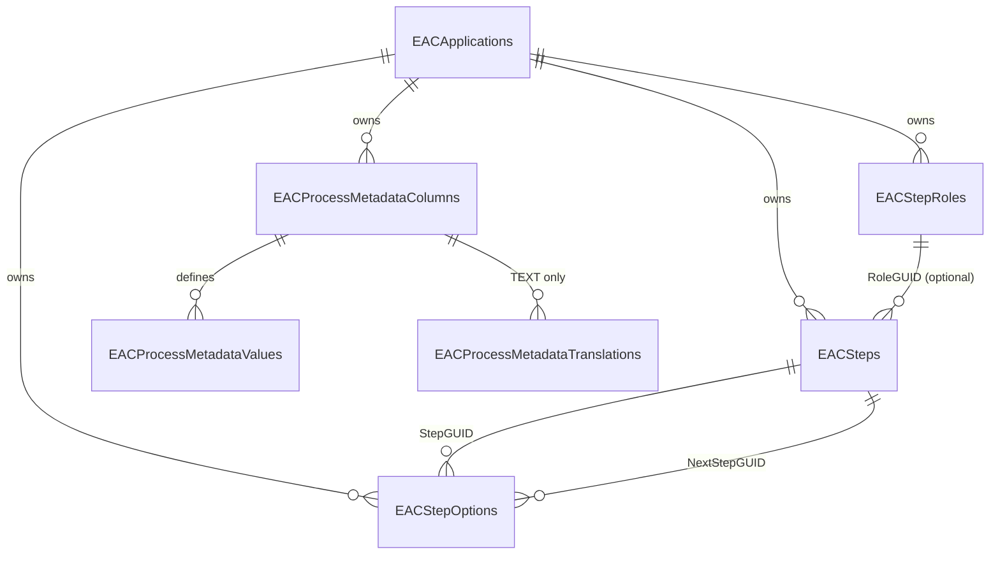

# Architecture — Process Framework

Owner: Architecture

The Process Framework is the **Application Configuration metadata foundation** for a future Process Automation Workflow Engine. It lets administrators define **Roles**, **Steps**, and **Options** (plus extra metadata fields) per Application in EAC.

> **Documentation exception (approved):** the *Business vision* section below describes the future Workflow Engine. Every other section describes **implemented reality**. The Workflow Engine itself is **not implemented** — there are no instance tables, task assignment, runtime state machine, or assignment APIs.

Decision: [ADR-019](../../decisions/ADR-019-process-framework-metadata.md). Deployment: [application-configuration-deployment.md](../app-configuration/application-configuration-deployment.md). JSON contract: [`docs/data-portability.md`](../../docs/data-portability.md). Product surface: [architecture/eac.md](../eac.md). Schema inventory: EAC [`docs/db-model.md`](https://github.com/Breeze-On/SYSTEM-ADMIN-EAC/blob/main/docs/db-model.md) · EAC [`docs/process-framework.md`](https://github.com/Breeze-On/SYSTEM-ADMIN-EAC/blob/main/docs/process-framework.md).

## Business vision (future engine consumption)

| Concept | Meaning | Future engine use |
| --- | --- | --- |
| **Role** | Who receives work | Resolve assignees (today: a Security Group referenced by `AttributeCode` within an Application Context) |
| **Step** | What work or state exists | The current task, or a terminal / informational state |
| **Option** | How the user responds and where the flow goes next | An edge from the current Step to `NextStepCode` |

- **Terminal completion** is modelled as ordinary Steps (for example `approved`, `rejected`, `cancelled`) — there is no special "workflow complete" construct. An Option that points at a terminal Step ends the flow.
- A Step with **no Role** is informational / a state (no task assignment).
- Metadata columns add business attributes (labels, categories, thresholds, a responsible person) that the future engine can read alongside the structure.

## Current reality

### Scope and ownership

- **Application-scoped** (`ApplicationGUID`) — Roles, Steps, Options, and the metadata column catalog. Not owned by an Application Context; Context delete does not touch them, Application delete removes them.
- Surfaced in EAC on `/app-configuration` as the **Process Framework** tab with three cards — **Roles**, **Steps**, **Options**. Each card has an **Entity | Settings** toggle (same Values/Settings pattern as Data Entities). Entity mode is a `BoShuffleCardGrid` (Security Groups pattern: Save / Discard, reorder, delete, add — **no Manage Members**). Settings mode is **entity-scoped**: one shared `ProcessMetadataSettingsWorkspace` configured with the current entity (Role / Step / Option) shows only catalog rows owned by that entity (`ProcessFrameworkEntity`). Add New creates a row for the current entity only; Delete always hard-deletes that entity’s row (cascades values/translations). The same Code may exist once per entity as independent rows. Save still sends the **full** Application catalog (strict server accounting). Navigating between Roles / Steps / Options always opens the **Entity** view.
- **UI conventions:** Entity and Settings Shuffle Cards use the locked **leading** reorder + delete track (platform standard — no placement override) and `minmax(0, …fr)` tracks. Reference dropdowns show `Name (code)` — Step **Role** and Option **Step** / **Next Step** use the Role / Step `name` (else `description`) metadata value for the current language, falling back to the code alone — while the **Code** is persisted; Step Role is optional and clearable. Column titles are **Role**, **Step**, **Next Step**, **Data Entity** (not "… Code"), and no Process Framework control uses a custom placeholder ([ux-conventions.md](../../docs/ui/patterns/ux-conventions.md) § Placeholders).
- Authorization is the same as other Application Configuration sections: Global System Administrator or the Application's `APP_*` administrator group ([eac-authorization-matrix.md](../authorization/eac-authorization-matrix.md)).
- Portability is **only** Application Configuration JSON. There is no separate import/export for Process Framework.

### Entities

| Entity | Portable fields | Notes |
| --- | --- | --- |
| Role (`EACStepRoles`) | `code`, `type`, `securityGroupAttributeCode`, `sortOrder`, `metadata` | `type` is `Group` only. `securityGroupAttributeCode` (`[A-Z0-9_]+`) is a soft reference to a Security Group `AttributeCode` — no foreign key; resolved per Application Context by the future engine. Delete blocked while Steps reference the Role. |
| Step (`EACSteps`) | `code`, `roleCode?`, `sortOrder`, `metadata` | Optional Role (null = informational). Delete blocked while Options reference it as Step or Next Step. |
| Option (`EACStepOptions`) | `stepCode`, `code`, `nextStepCode`, `sortOrder`, `metadata` | Code unique per Step. `nextStepCode` required. |

Codes are lowercase kebab-case, unique within the Application (Options within their Step).

### Metadata engine

One catalog table (`EACProcessMetadataColumns`) per Application; each row is owned by exactly one entity (`ProcessFrameworkEntity` = `ROLE` | `STEP` | `OPTION`). The same Code may appear once per entity as independent rows. Values are sparse typed rows (`EACProcessMetadataValues`); `TEXT` values are translatable (`EACProcessMetadataTranslations`, one row per language).

| `DataType` | Stored value | Editor |
| --- | --- | --- |
| `TEXT` | Translations per language (`en-CA` / `fr-CA`) | `BoTextField` (current language) |
| `NUMBER` | Decimal, rounded to column `Decimals` (0..10, default 2) | `BoNumberField` |
| `DATE` / `DATETIME` | Date-time | `BoDateField` |
| `BOOLEAN` | Bit | `BoCheckbox` |
| `DDL` (labeled **Data Entity**) | Data Entity **row Code** (column carries `DataEntityCode`) | `BoDropDownList` of the column's Data Entity rows in the selected Application Context (Code persisted, Description shown); Settings picks the Data Entity via a `BoDropDownList` of the Application's Data Entities (**Disabled** unless Data Type is Data Entity; **Decimals** is **Disabled** unless Data Type is Number) |
| `PEOPLEPICKER` | **`Identity.Users.ExternalObjectId`** (never `UserGUID`) | `BoPeoplePicker` bound to `UserGUID`; EAC adapter converts to / from `ExternalObjectId` |

- `DDL` and `PEOPLEPICKER` exist **only** in Process Framework metadata; Data Entity column types are unchanged ([ADR-019](../../decisions/ADR-019-process-framework-metadata.md)).
- Type is immutable after create. `IsRequired` and `DisplayOrder` are enforced on save.
- **Column `Description` is required** (`NOT NULL`, ≤ 250) and **localized**: `DescriptionTranslations` (JSON language map) holds per-language labels; `Description` is the portable fallback (en-CA when present). In Application Configuration JSON, `description` is a string **or** a language map (like TEXT metadata); export writes the map when translations exist.
- **Deleting a metadata column always cascades** (translations → values → column) and is never blocked by existing values.

### Code vs GUID

Database relationships use GUID foreign keys; the UI, JSON, and soft references use **Codes**. Application Configuration JSON never contains GUIDs.

### Application Configuration JSON

Portable file shape: nested `processFramework.{steps|options|roles}.{metadataColumns|values}` (schemaVersion **2**; dual-read of schemaVersion **1** flat keys). Ownership of metadata columns is path-implied. Sync order: metadata columns → roles → steps → options (removals in reverse; column removals cascade). The sync SP still receives a flat payload; EAC normalizes at the boundary. Field tables: [`docs/data-portability.md`](../../docs/data-portability.md#process-framework-sections).

### ERD

`EACProcessMetadataValues` / `EACProcessMetadataTranslations` reference their owner through `OwnerType` (`ROLE` | `STEP` | `OPTION`) + `OwnerGUID` (soft reference, no foreign key).

Logical Code graph: `Role.code` ← `Step.roleCode`; `Step.code` ← `Option.stepCode` / `Option.nextStepCode`; `Role.securityGroupAttributeCode` ↔ Security Group `AttributeCode` (per Application Context, runtime).

## Ownership

| Concern | Owner |
| --- | --- |
| Tables, SPs, UI, validation, JSON sync | SYSTEM-ADMIN-EAC (`System` schema, `Components/ProcessFramework`) |
| Platform architecture, vision, decision | STANDARDS (`architecture/process-framework/`, ADR-019) |

## Definition of Done

Any change affecting Process Framework **schema**, **metadata types**, **JSON contract**, or **rules** is incomplete until this tree, [ADR-019](../../decisions/ADR-019-process-framework-metadata.md), [`docs/data-portability.md`](../../docs/data-portability.md), the app-configuration deployment doc, EAC [`docs/db-model.md`](https://github.com/Breeze-On/SYSTEM-ADMIN-EAC/blob/main/docs/db-model.md), and thin product pointers are updated in the **same change set**. Keep the vision section clearly separate from implemented reality.
