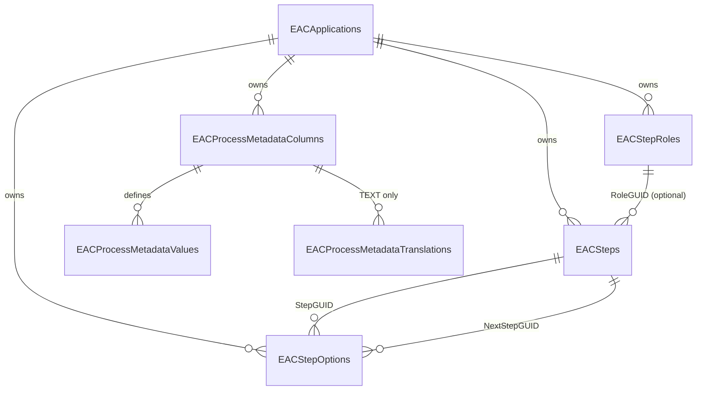

<!-- Classification: AA; Scope: application:eac; Domain: Platform; Capability: ProcessFramework -->
# Architecture — Process Framework

Owner: Architecture (EAC domain)

**Process Framework is an EAC business capability and metadata model** — not a platform workflow engine. Multi-application consumption of PF is **Future Validation**. Implementation lives in SYSTEM-ADMIN-EAC.

The Process Framework lets Application Administrators define **one process definition per Application**: who acts (**Roles**), what happens (**Steps**), and how work moves (**Options** / routes), plus optional business attributes (metadata). PF stores and governs that definition only; it does not execute process instances. A future Process Automation Workflow Engine may consume this metadata; the engine itself is **not implemented**.

## Application adoption boundary

- PF is **metadata only**. It does not provide runtime instances, task assignment, state transitions, or execution services.
- An application may own and implement its own runtime against PF metadata. That application-owned runtime is an approved architecture boundary; it does not make the runtime part of PF or the platform.
- A platform workflow engine is **not a prerequisite for Application #2** or another BreezeOn product application. Do not block application adoption on an unshipped engine.
- If an application does not need PF metadata, it is not required to adopt the EAC PF capability. Multi-application PF consumption remains Future Validation.

> **DEV-001:** Only the [Business vision (future engine)](#business-vision-future-engine) section is non-normative. All **authoring semantics** (Role, Step, Option, Terminal, Informational, Routing, Outcome, Entry Step, graph rules) in this document are **normative current reality**.

Decision: [ADR-019](../../decisions/ADR-019-process-framework-metadata.md). Authoring: [authoring-guide.md](authoring-guide.md). AI contract: [ai-authoring-contract.md](ai-authoring-contract.md). Examples: [worked-examples.md](worked-examples.md). Construct selection: [construct-selection.md](../app-configuration/construct-selection.md). JSON: [`docs/data-portability.md`](../../docs/data-portability.md). Product: [eac.md](../applications/eac.md). Schema: EAC [`docs/db-model.md`](https://github.com/Breeze-On/SYSTEM-ADMIN-EAC/blob/main/docs/db-model.md) · thin pointer [`docs/process-framework.md`](https://github.com/Breeze-On/SYSTEM-ADMIN-EAC/blob/main/docs/process-framework.md).

---

## Business meaning (normative)

### What problem PF solves

Organizations need a **governed definition** of how work moves through approvals, reviews, and operational hand-offs — who is expected to act, what states exist, and which decisions take the process where next — **without** writing code or inventing per-app workflow tables.

### One Application = one Process Definition (PF v1)

| Rule | Meaning |
| --- | --- |
| **Application** | Exactly **one** Process Framework process definition |
| **Multiple business processes** | Require **multiple Applications** |
| **Process entity** | **Not** a separate table in PF v1 |
| **Process vs Step** | The Application *is* the process; Steps are activities/states *inside* that one definition |
| **Future Process grouping** | Future Validation (do not invent multi-process Applications now) |

Administrators and AI agents: if requirements describe a second distinct process (for example Purchase Approval **and** Vendor Review as separate flows), create a **new Application** — do not overload one Application’s Step/Option graph.

### Responsibility table (normative)

| Concept | Business meaning | Is / is not |
| --- | --- | --- |
| **Role** | Business actor group — **who is expected to act** | **Not** an authorization artifact or security permission grant. Soft-links to an App Config Security Group via `securityGroupAttributeCode` for assignment context. |
| **Step** | Business activity or state | A place in the process where work happens or a state is recorded |
| **Option** | Business decision or response | How an actor responds; routes to a **Next Step** |
| **Route** | The directed edge Option → Next Step | Explicit routing decision |
| **Outcome** | Reaching a **Terminal Step** | End of the flow for that instance (when an engine exists) |

### Valid Step shapes (normative)

| Shape | Requirements | Meaning |
| --- | --- | --- |
| **Actionable Step** | Has a **Role** and **one or more Options** | Someone is expected to act and choose a response |
| **Terminal Step** | **No Options** (outgoing) | End state / outcome (for example Approved, Rejected) |
| **Informational Step** | **No Role** and no action required | State / notice; typically also no Options when used as a pure state |
| **Role-less Step with Options** | — | **Undefined in PF v1** — do not author this shape |

### Entry Step, loops, graph lint (normative)

| Rule | Detail |
| --- | --- |
| **Entry Step** | The Step with the **lowest `sortOrder`** |
| **Loops / cycles** | **Allowed** and supported (for example return-for-correction) |
| **Graph lint** | Import Analysis emits **warnings only** (never fails import): no terminal Step; unreachable Step(s); Step with a Role and zero Options |

### What PF v1 can express

- Sequential workflows  
- Approval workflows  
- Review workflows  
- Explicit routing decisions (actor picks an Option)

### What PF v1 cannot express

- Conditions / rules engines  
- Parallel branches  
- Escalations / timers  
- Quorum approvals  
- Delegation  
- Dynamic routing  
- Step data capture (forms/fields collected at a Step)

Register advanced workflow capabilities as **Future Validation** only — do not invent engine design here.

### Ownership (business)

| Role | Reality today |
| --- | --- |
| **Application Administrators** (GSA or Application `APP_*`) | Own and change PF definitions |
| **Process Owners** | **Not modelled** |
| **Formal change control / versioning** | **Future Validation** |

### Display name conventions (metadata)

Reserved **conventions** (not first-class columns): metadata Codes **`name`** and **`description`** on Roles, Steps, and Options. UI reference dropdowns prefer `name`, then `description`, then Code. Keep seed, examples, and authoring guidance consistent with these Codes. Do **not** invent first-class Name/Description fields in PF v1.

### Process History conventions (normative when the app uses Process History)

Decision: [ADR-025](../../decisions/ADR-025-process-history.md). UI: [process-history.md](../../docs/ui/patterns/process-history.md).

| Rule | Detail |
| --- | --- |
| **Entry / Initiation Step** | Lowest `sortOrder` Step **must** have code **`00`** (PanelInitiation ≡ step `00`) |
| **Submit** | Option **`va`** on step `00` is **required** |
| **Save** | Option **`va1`** on step `00` is **optional**; absence → hide initiation Save |
| **`va1` scope** | Save meaning applies **only** on step `00`. Never infer Save from `va1` on any other step |
| **`response-status`** | Mandatory conventional Option metadata Code on **every** option that can generate a Process History record. Missing / empty = invalid PF configuration |

Runtime ledger is `Global.ProcessHistory` (EAC). PF tables remain definition-only.

### Operating envelope

- Designed for **moderate** catalogs (tens of Steps/Options/columns).  
- Limits are **not fully tested**.  
- Scalability validation remains **Future Validation**.  
- Do not claim unproven large-catalog performance.

---

## Business vision (future engine)

Non-normative under [DEV-001](../../docs/deviations/DEV-001-process-framework-future-engine-vision.md). Describes how a **future** Process Automation Workflow Engine might consume the metadata above (instances, task assignment, runtime state machine). **Not implemented** — no instance tables, assignment APIs, or runtime engine.

---

## Current reality (technical)

### Scope and surface

- **Application-scoped** (`ApplicationGUID`). Not owned by Application Context; Context delete does not touch PF; Application delete removes it.
- UI: `/app-configuration` → **Process Framework** tab. Card order matches UI: **Steps**, **Options**, **Roles**. Each card has **Entity | Settings**. See [authoring-guide.md](authoring-guide.md).
- Authorization: Global System Administrator or Application `APP_*` ([eac-authorization-matrix.md](../applications/eac-authorization-matrix.md)).
- Portability: Application Configuration JSON only.

### Entities

| Entity | Portable fields | Notes |
| --- | --- | --- |
| Role (`EACStepRoles`) | `code`, `type`, `securityGroupAttributeCode`, `sortOrder`, `metadata` | `type` is `Group` only (required). Soft ref to Security Group `AttributeCode` — **no FK**; AttributeCode may be renamed without cascading. Runtime resolution = Future Validation. Delete blocked while Steps reference the Role. |
| Step (`EACSteps`) | `code`, `roleCode?`, `sortOrder`, `metadata` | Optional Role. Delete blocked while Options reference it as Step or Next Step. |
| Option (`EACStepOptions`) | `stepCode`, `code`, `nextStepCode`, `sortOrder`, `metadata` | Code unique per Step. `nextStepCode` required. |

Codes are lowercase kebab-case, unique within the Application (Options within their Step).

### Metadata engine

One catalog (`EACProcessMetadataColumns`) per Application; each row owned by exactly one entity (`ROLE` | `STEP` | `OPTION`). Values sparse (`EACProcessMetadataValues`); `TEXT` translatable (`EACProcessMetadataTranslations`).

| `DataType` | Stored value | Editor |
| --- | --- | --- |
| `TEXT` | Translations; **authoritative language `en-CA`** | `BoTextField` |
| `NUMBER` | Decimal, rounded to column `Decimals` (0..10, default 2) | `BoNumberField` |
| `DATE` / `DATETIME` | Date-time | `BoDateField` |
| `BOOLEAN` | Bit | `BoCheckbox` |
| `DDL` (labeled **Data Entity**) | Data Entity **row Code** | `BoDropDownList` of rows in selected Application Context |
| `PEOPLEPICKER` | **`Identity.Users.ExternalObjectId`** (never `UserGUID`) | `BoPeoplePicker` + EAC adapter |

- `DDL` / `PEOPLEPICKER` are PF-only; Data Entity column types unchanged ([ADR-019](../../decisions/ADR-019-process-framework-metadata.md)).
- Type immutable after create. Column `Description` required and localized (`DescriptionTranslations`); portable fallback prefers en-CA.
- Column delete always cascades.

### Soft references and import warnings

- When `roles` and `securityGroups` both participate in an import file, Import Analysis **warns** if a Role’s `securityGroupAttributeCode` is not among the file’s Security Groups (dangling soft ref). Does not fail import.
- Runtime resolution of AttributeCode / DDL / PEOPLEPICKER per Application Context remains **Future Validation**.

### Code vs GUID

Database relationships use GUID FKs; UI, JSON, and soft references use **Codes**. Application Configuration JSON never contains GUIDs.

### Application Configuration JSON

Nested `processFramework.{steps|options|roles}.{metadataColumns|values}` (schemaVersion **2**; dual-read schemaVersion **1** flat keys). Sync order: metadata columns → roles → steps → options (removals reverse). Field tables: [`docs/data-portability.md`](../../docs/data-portability.md#process-framework-sections). AI field contract: [ai-authoring-contract.md](ai-authoring-contract.md).

### ERD

Logical Code graph: `Role.code` ← `Step.roleCode`; `Step.code` ← `Option.stepCode` / `Option.nextStepCode`; `Role.securityGroupAttributeCode` ↔ Security Group `AttributeCode` (per Application Context, runtime FV).

---

## Ownership (technical)

| Concern | Owner |
| --- | --- |
| Tables, SPs, UI, validation, JSON sync | SYSTEM-ADMIN-EAC |
| EAC-domain architecture, authoring semantics, examples | STANDARDS (`architecture/process-framework/`, ADR-019) |

## Definition of Done

Any change affecting Process Framework **schema**, **metadata types**, **JSON contract**, **authoring semantics**, or **rules** is incomplete until this tree, [ADR-019](../../decisions/ADR-019-process-framework-metadata.md), [`docs/data-portability.md`](../../docs/data-portability.md), app-configuration deployment, EAC [`docs/db-model.md`](https://github.com/Breeze-On/SYSTEM-ADMIN-EAC/blob/main/docs/db-model.md), and thin product pointers are updated in the **same change set**. Keep the vision section clearly separate from normative authoring reality.
