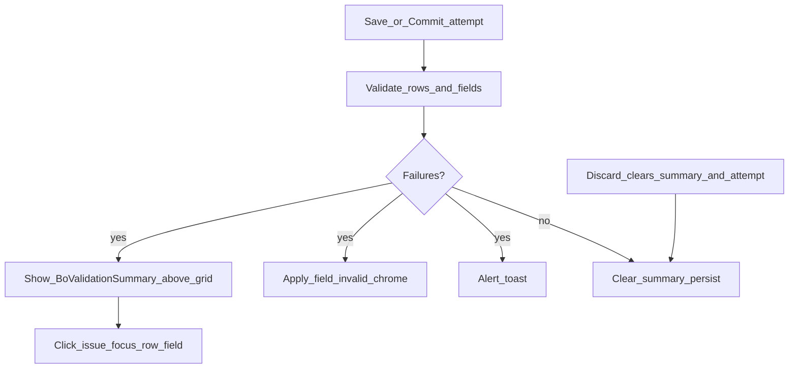

<!-- Classification: H; Scope: platform -->
> **Historical — not authoritative.** Retained for implementation history after knowledge promotion.

---
name: Grid Shuffle Validation
overview: Define a platform-standard, reusable collapsible validation summary (with row/field navigation and existing field chrome) for BoGrid, BoShuffleCardGrid, and future configuration editors—standards and SHARED-UI first, then Process Framework remediations.
todos:
  - id: standards-adr
    content: Author validation-summary.md (incl. Adoption Matrix) + ADR; delta grids/shuffle/forms/import-summary/dirty-state/page-development/ux-conventions; link matrix from Planning Agent guidance
    status: completed
  - id: shared-ui-summary
    content: Add BoValidationIssue + BoValidationSummary + focus/navigate APIs + Gallery in SYSTEM-SHARED-UI
    status: completed
  - id: bogrid-wire
    content: Integrate Validation Summary into BoGrid post-attempt failure path
    status: completed
  - id: shuffle-host-kit
    content: Document Shuffle host composition + FocusRowAsync helpers without embedding validation
    status: completed
  - id: eac-p0
    content: Remediate Process Framework Roles/Steps/Options + Metadata Settings
    status: completed
  - id: eac-p1-p2
    content: Remediate Security Groups, Data Entity Edit, Values/Settings workspaces
    status: in_progress
isProject: false
---

# Grid & Shuffle Card Validation Experience Standard

## Verdict (design answers)

1. **BoGrid standard:** Yes — after a Save/Commit validation attempt, when one or more field/row failures exist, BoGrid surfaces a collapsible validation summary **above** the table (in addition to existing field chrome + Alert toast).
2. **BoShuffleCardGrid standard:** Yes as a **host composition rule** — Shuffle remains host-owned for validation (locked today); hosts **must** place the shared summary above Shuffle content. Library adds navigate/focus helpers; it does **not** embed Save/Dirty/validation.
3. **Reusable summary rendering:** Yes — new SHARED-UI presentational control `BoValidationSummary`.
4. **Navigate-to-error:** Yes — each issue is actionable; click scrolls/focuses the target row (and field when addressable).
5. **Error counts in headers:** Yes — summary title is `Errors (n)` (and `Warnings (n)` when warnings are shown). Existing section/tab fail badges remain complementary, not replacements.
6. **Collapsed/expanded:** Built on `BoExpandableSection` / disclosure engine. Default **expanded** when a failed Save attempt introduces or increases errors; user may collapse; re-expand on a new failed attempt or rising error count; hide entirely when valid or after Discard/Reset.
7. **Integrations:** Dirty stay-on-fail unchanged; Save populates summary; Discard clears summary + validation attempt; Import Summary stays a **separate** pre-apply dialog pattern; configuration editors adopt the same page/dialog composition.

## Recommended UX pattern

**Name:** Validation Summary (live editor) — distinct from Import Summary (pre-apply review).

**Placement:** Immediately above `BoGrid` / `BoShuffleCardGrid` content (below section header / filters).

**Chrome:**
- Collapsible band titled `Errors (n)` (optional second band or mixed list for warnings).
- Concise row-oriented lines: `Row {label} → {Field}: {actionable message}` (e.g. `Row 2 → Description is required`).
- Clickable rows for navigate-to-error.
- Visible only after a validation **attempt** (deferred validation preserved from [forms.md](C:\Users\david\Projects\STANDARDS\docs\ui\controls\forms.md) / Grid Family).
- Field highlighting continues via existing `bo-field--invalid` / `ErrorText` rules — summary does not replace chrome.

## Reusable component strategy (SYSTEM-SHARED-UI)

| Piece | Responsibility |
| --- | --- |
| `BoValidationIssue` | Structured issue: `Severity`, `RowKey`, `RowLabel`, `FieldKey`, `FieldLabel`, `Message` |
| `BoValidationSummary` | Presentational collapsible list above editor content; count in title; click raises `OnIssueActivated` |
| Focus helpers | Extend `bo-grid.js` / grid public APIs: focus/scroll by `ItemKey` (+ optional field) for table and Shuffle rows |
| Gallery demo | Components Library example for summary + navigate |

**Boundaries (locked):**
- SHARED-UI stays presentational — no product validators, analyzers, or SQL.
- Do **not** overload `BoImportSummaryDialog` / `BoImportIssueRow` for live editors (dialog + Type·Message + confirm gate remain Import-only per [import-summary.md](C:\Users\david\Projects\STANDARDS\docs\ui\patterns\import-summary.md)).
- **Generalize concepts**, not the dialog: Error blocks commit; Warning does not; concise issue list; severity vocabulary aligned where useful.
- Prefer extending `BoValidationContext` consumption over inventing a second failure store. Today `BoValidationFailure` is key-only ([BoValidationFailure.cs](C:\Users\david\Projects\SYSTEM-SHARED-UI\src\BreezeOn.UI\Validation\BoValidationFailure.cs)) — extend the model (or a parallel display DTO) so summaries can show **labels + messages**, not only keys.

**Host mapping (Shuffle / custom validators):** Hosts map domain errors → `IReadOnlyList<BoValidationIssue>` and bind `BoValidationSummary`. Replace ad-hoc `eac-security-groups-edit__errors` `<ul>` lists.

## BoGrid impact

- After InlineEdit / RowEdit / host Save validation attempt fails, render `BoValidationSummary` above the table when failures exist.
- Keep: deferred chrome, Alert toast, grid `Required` helper, section/tab fail badges.
- Add: optional suppress parameter only for exceptional tiny surfaces; default is **on** when failures exist.
- Wire navigate-to-error to row/cell focus using existing grid focus infrastructure (`focusFirstEditableInRow` and successors).

Primary specs to update: [grids.md](C:\Users\david\Projects\STANDARDS\docs\ui\controls\grids.md).

## BoShuffleCardGrid impact

- **No** embedding of validation/Dirty/Save inside Shuffle (preserve [shuffle-card-grid.md](C:\Users\david\Projects\STANDARDS\docs\ui\controls\shuffle-card-grid.md) ownership table).
- STANDARDS host rule: multi-row editable Shuffle editors **must** compose `BoValidationSummary` above the grid after failed Save.
- Library additions: `FocusRowAsync` / field focus by `ItemKey` (build on `focusFirstEditableInShuffleRow`).
- Hosts that set `Required` on cell fields must either cascade `BoValidationContext` + `Validate()` on Save **or** set per-field `ErrorText` so chrome matches the summary (fixes today’s asterisk-only / list-only gap).

## Validation summary design

- **Title:** `Errors (n)`; collapsed trigger still shows count.
- **Body:** one line per issue; stable order (row order, then column/field order).
- **Action:** click → expand if needed → scroll into view → focus target control.
- **Empty:** unmounted / not rendered (no empty shell).
- **Warnings:** allowed in the same control as non-blocking severity; Errors remain the Save blocker.
- **i18n:** shared resource keys in SHARED-UI; hosts supply message text for domain rules.

## Validation Summary Adoption Matrix

Lightweight usage matrix (same role as Dirty State / Configuration Session Cache Invalidation matrices). Ships in future STANDARDS `docs/ui/patterns/validation-summary.md` and is referenced from Planning Agent guidance so adoption is not ad hoc.

**Legend**
- **Required** — Validation Summary after failed Save/Commit when failures exist; field chrome + Alert toast + navigate-to-error are co-required.
- **Optional** — Field chrome + toast (and section/tab fail badges when applicable) are the baseline; add Validation Summary when failures are easy to miss (long scroll, many fields, or mixed row/field errors).
- **Not Recommended** — Do not use Validation Summary; use the named sibling pattern instead.

**Experience → Adoption**
- **BoGrid editable multi-row editors** — **Required** (InlineEdit / RowEdit / host Save over multiple rows). Navigate-to-error **Required**. Field chrome **Required**. Toast **Required**.
- **BoShuffleCardGrid editable experiences** — **Required** (host composition above Shuffle). Navigate-to-error **Required**. Field chrome **Required**. Toast **Required**.
- **App Configuration screens** — **Required** when the screen hosts editable multi-row BoGrid or BoShuffleCardGrid; otherwise follow Large forms / Small forms / Dialogs rows below. Do not invent per-tab list UX.
- **Settings editors** — **Required** when the editor is a multi-row grid/shuffle catalog (e.g. Process Metadata Settings); **Optional** for large multi-section settings forms without a multi-row editor; **Not Recommended** for tiny single-entity settings.
- **Large forms** — **Optional**. Baseline: deferred field chrome + Alert toast + section/tab fail badges. Add Validation Summary when a single Save can produce many failures across a long scrolling surface and hunting is likely. Navigate-to-error **Required** when summary is used.
- **Small forms** — **Not Recommended**. Field chrome + Alert toast are enough; section fail badges when the form uses sections/tabs.
- **Dialogs** — **Required** when the dialog body hosts an editable multi-row BoGrid/Shuffle; **Not Recommended** for small single-entity create/edit dialogs (field chrome + toast / footer message). Prefer summary inside the dialog body above the grid, not a second competing footer list.
- **Import workflows** — **Not Recommended**. Use Import Summary (`BoImportSummaryDialog` Errors and Warnings) for pre-apply review. Do not dual-stack Validation Summary on the same analyze/confirm path.
- **Wizard experiences** — **Optional** on a step that embeds a multi-row editable grid/shuffle (**Required** for that embedded editor); **Not Recommended** on simple single-entity wizard steps (field chrome + toast).
- **Single-field actions** — **Not Recommended**. Field chrome and/or Alert toast only.
- **Bulk-edit experiences** — **Required**. Multi-target failures need row/item-oriented summary + navigate-to-error; toast alone is non-compliant.

**Planning Agent evaluation (use this matrix every time)**
1. Is Validation Summary **Required / Optional / Not Recommended** for this experience?
2. Is **field chrome** enough alone? Only when the matrix says Not Recommended or Optional and failures remain in viewport without hunting.
3. Is a **toast** enough alone? Never for Required rows; toast remains co-required with chrome (and summary when Required).
4. Should **navigate-to-error** be available? Yes whenever Validation Summary is used; Required for all Required matrix rows.

## Error highlighting strategy

- Keep SSOT in [forms.md](C:\Users\david\Projects\STANDARDS\docs\ui\controls\forms.md): danger on **control edge only**, after attempt, live clear via `NotifyFieldChanged()`.
- Summary + chrome + toast are **co-required** for multi-row editors after failed Save (toast alone or list alone is non-compliant).
- Row wash / card outline is **out of scope** unless a later ADR changes forms chrome.

## Integration rules

| Concern | Behavior |
| --- | --- |
| Dirty State | Validation failure keeps dirty; summary stays on page ([dirty-state.md](C:\Users\david\Projects\STANDARDS\docs\ui\patterns\dirty-state.md)) |
| Save | Begin attempt → validate → populate issues → summary + chrome + toast |
| Discard | Clear issues, reset attempt, collapse state discarded with remount/reset |
| Import validation | Keep `BoImportSummaryDialog`; do not replace with page Validation Summary |
| Configuration screens | Same composition: summary above grid/shuffle; fail badges when sections/tabs used |

## Documentation / standards updates required

**STANDARDS (new + delta):**
- **New** `docs/ui/patterns/validation-summary.md` — SSOT for live-editor Validation Summary (UX, collapse rules, navigate-to-error, host composition, severity, anti-patterns, **Validation Summary Adoption Matrix**).
- **Delta** `docs/ui/controls/grids.md` — Grid Family + BoGrid: summary above table after attempt.
- **Delta** `docs/ui/controls/shuffle-card-grid.md` — host must compose summary; focus APIs.
- **Delta** `docs/ui/controls/forms.md` — cross-link; summary does not replace field chrome.
- **Delta** `docs/ui/patterns/import-summary.md` — clarify sibling pattern (pre-apply vs live editor); shared severity concepts only.
- **Delta** `docs/ui/patterns/dirty-state.md`, `docs/ui/page-development.md`, `docs/ui/patterns/ux-conventions.md`, `docs/ui/overview.md` — checklist / index links.
- **Delta** Planning Agent guidance (`docs/ai/planning-and-development-agents.md` and/or AI quickstart as applicable) — require Adoption Matrix evaluation (summary vs chrome vs toast vs navigate) before inventing validation UX.
- **New ADR** under STANDARDS `decisions/` — Validation Summary as platform contract (ADR-004 alignment: Bo* + docs/ui currency).

**Product docs (when remediating):** thin EAC `README_AI.md` / feature notes only if Process Framework / Security Groups behavior changes in that change set.

## Retroactive remediation candidates

**P0 (large hunting surfaces — Process Framework origin):**
1. Roles / Steps / Options (`ProcessEntityTabBase`, entity tabs)
2. Process Metadata Settings (`ProcessMetadataSettingsWorkspace`)

**P1 (same anti-pattern):**
3. Security Groups (`SecurityGroupsTab` + `eac-security-groups-edit__errors`)
4. Data Entity Edit dialog (`DataEntityEditDialog` footer error list)

**P2:**
5. Data Entity Values / Settings workspaces (toast-only; add summary + chrome where multi-field Save fails)
6. Any future App Configuration editors using Shuffle + string error lists

## Implementation phases (after plan approval — not this exercise)

1. **Standards + ADR** — lock Validation Summary pattern, Adoption Matrix, and Grid/Shuffle rules (docs-only).
2. **SHARED-UI foundation** — `BoValidationIssue`, `BoValidationSummary`, focus/navigate APIs, Gallery, resource strings; extend failure/display model as needed.
3. **BoGrid integration** — auto summary above table from validation failures after attempt.
4. **Shuffle host kit** — document + helpers; no ownership change.
5. **EAC P0 remediation** — Process Framework Roles/Steps/Options + Metadata Settings (replace bottom `<ul>`, wire chrome + navigate).
6. **EAC P1/P2 remediation** — Security Groups, Data Entity Edit, Values/Settings.
7. **Done criteria** — docs current-reality, Gallery demo, knowledge moved out of plan into STANDARDS; move plan to `docs/plans/implemented/`.

## Explicit non-goals

- Implementing UI in this planning exercise.
- Merging Import Summary and Validation Summary into one control.
- Changing Shuffle ownership of Dirty State / Save.
- Red row washes or non-deferred validation on Add New.
